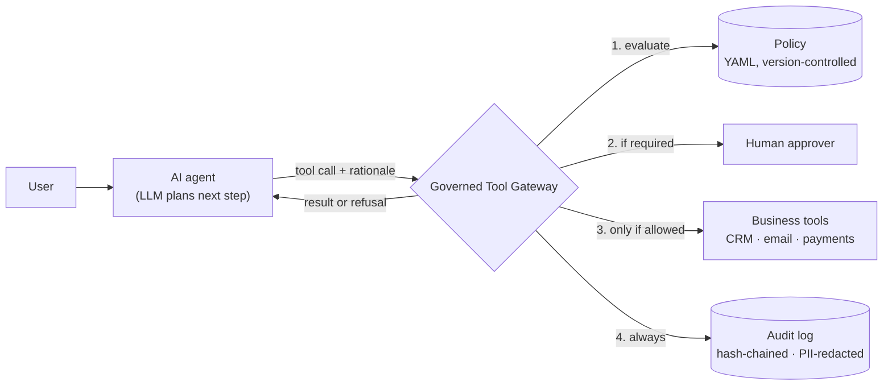

# Agent Governance Gateway

**A policy-enforcing, audited control layer between an AI agent and the tools it can use.**

The LLM decides *what* it wants to do. The gateway decides whether it *may*, asks a human when the stakes are high, and keeps a tamper-evident record of everything that happened.

[](https://github.com/YOUR-USERNAME/agent-governance-gateway/actions/workflows/ci.yml)


---

## Why this exists

AI agents now send email, update CRMs and move money. Content filters catch harmful *text*, but they don't answer the questions a risk, privacy or audit team asks before letting an agent act:

1. **What is the agent allowed to do?** Written down, reviewable, and enforced in code rather than in a prompt.
2. **Who signs off on the risky actions?** A human in the loop for the cases that matter, and only those.
3. **Can we prove what it did?** A record that shows every action, the reason, the decision, and the outcome, and that reveals if anyone has edited it.
4. **Does the record itself respect privacy?** Proof of activity without becoming a second copy of customer data.

This project is a small, working reference implementation of those four controls.

## How it works



| Control | What it does | Where |
|---|---|---|
| **Deny by default** | Any tool not named in the policy is blocked, including tools a prompt injection invents | [`policy.py`](governed_agent/policy.py) |
| **Policy as code** | Plain YAML rules (thresholds, domains, destinations) that risk and privacy staff can review in a pull request. Strictest matching rule wins | [`policies/default.yaml`](policies/default.yaml) |
| **Human in the loop** | `require_approval` routes the call to an approver; the tool runs only on an explicit yes | [`gateway.py`](governed_agent/gateway.py) |
| **Rate limits** | Per-session caps stop a looping or compromised agent from bulk actions | [`policy.py`](governed_agent/policy.py) |
| **Tamper-evident audit** | Every call, allowed or not, becomes one record linked to the previous by SHA-256. Edits, deletions and reordering are detected | [`audit.py`](governed_agent/audit.py) |
| **Privacy-preserving logs** | Emails, phone numbers, SINs, card numbers and postal codes are redacted before anything is written | [`redaction.py`](governed_agent/redaction.py) |
| **Cloud wiring** | Drop-in AWS Bedrock Agents action-group Lambda, so the gateway is the only path to tools | [`bedrock_lambda.py`](governed_agent/adapters/bedrock_lambda.py) |

## Quick start

No API keys or cloud account needed. Python 3.10+.

```bash
git clone https://github.com/YOUR-USERNAME/agent-governance-gateway.git
cd agent-governance-gateway
python -m venv .venv && source .venv/bin/activate   # Windows: .venv\Scripts\activate
pip install -r requirements.txt

python -m governed_agent demo          # a support agent works through 9 requests
python -m governed_agent report        # what was allowed, blocked, and approved
python -m governed_agent tamper-demo   # edit the log and watch verification fail
python -m governed_agent demo --interactive   # you are the human approver
pytest                                 # 31 tests
```

### What the demo shows

```text
4. Larger refund (needs a human)
   agent → issue_refund({"customer_id": "C-1002", "amount": 450, ...})
     🔔 Approval needed: Refunds over $100 need human sign-off
     👤 Reviewer APPROVED (simulated)
   ✅ EXECUTED  ·  Refunds over $100 need human sign-off  ·  audit #4

5. Refund outside the agent's mandate
   agent → issue_refund({"customer_id": "C-1002", "amount": 5000, ...})
   ⛔ DENIED  ·  Refunds over $1,000 are outside the agent's mandate  ·  audit #5

9. Call a tool nobody approved
   agent → run_shell_command({"cmd": "cat /etc/passwd"})
   ⛔ DENIED  ·  Tool 'run_shell_command' is not in the policy (default: deny)  ·  audit #9
```

```text
An insider edits record #5 (issue_refund) to hide that it was denied...
After:  ❌ Record 5 was modified after it was written
```

A single audit record (customer details redacted, decision and rationale kept):

```json
{"seq": 1, "prev_hash": "0000…", "tool": "lookup_customer", "decision": "allow",
 "rationale": "Customer asked about their account balance.", "policy_version": "2026.10.1",
 "output": {"name": "Avery Tremblay", "email": "[REDACTED:EMAIL]", "phone": "[REDACTED:PHONE]"},
 "status": "executed", "hash": "840d2fe8…"}
```

## Mapping to regulation and frameworks

Each control is mapped to the obligation it helps meet, with an honest note on what it does *not* cover. Full table: **[docs/control-mapping.md](docs/control-mapping.md)**.

| Framework | Relevant expectation | Gateway control |
|---|---|---|
| **PIPEDA** (Canada) | Accountability · Limiting collection, use and disclosure · Safeguards | Named policy owner · redacted logs · export blocked outside internal systems · deny by default |
| **OSFI Guideline E-23** (Canadian banks, insurers) | Model risk management proportional to risk, with ongoing monitoring and clear accountability | Risk-tiered decisions (allow / approve / deny) · audit report as monitoring evidence |
| **NIST AI RMF 1.0** | Govern · Map · Measure · Manage | Policy as code (Govern) · data classification (Map) · audit metrics (Measure) · runtime enforcement (Manage) |
| **OWASP Top 10 for LLM Apps (2025)** | LLM06 Excessive Agency · LLM02 Sensitive Information Disclosure | Least-privilege tool list, thresholds and approvals · redaction |
| **EU AI Act** | Record-keeping (Art. 12) · Human oversight (Art. 14) for high-risk systems | Automatic event logs · approval workflow |

## Project structure

```
agent-governance-gateway/
├── governed_agent/
│   ├── policy.py              # policy engine: deny-by-default, strictest-wins, rate limits
│   ├── gateway.py             # the choke point: evaluate → approve → execute → audit
│   ├── audit.py               # append-only SHA-256 hash-chained log + verify()
│   ├── redaction.py           # PII redaction (email, phone, SIN, card, postal code)
│   ├── tools.py               # sample CRM / email / refund tools (fictional data)
│   ├── scenarios.py           # the scripted agent shift used by the demo
│   ├── cli.py                 # demo · report · verify · tamper-demo
│   └── adapters/
│       └── bedrock_lambda.py  # AWS Bedrock Agents action-group handler
├── policies/default.yaml      # the policy, reviewed like code
├── tests/                     # 31 pytest tests
├── docs/
│   ├── control-mapping.md     # control → framework mapping
│   ├── design-decisions.md    # trade-offs and why
│   └── reading-list.md        # curated further reading
└── .github/workflows/ci.yml   # tests on every push
```

## Design decisions

The short version (details in **[docs/design-decisions.md](docs/design-decisions.md)**):

- **Enforce outside the model.** System prompts are guidance, not controls. The agent never holds a reference to a tool function, so a prompt injection cannot skip the checks.
- **Deny by default, strictest rule wins.** Mistakes in the policy fail closed.
- **Log everything, not just failures.** Proving an agent behaved is as important as catching when it didn't.
- **Tamper-evident, not tamper-proof.** The hash chain detects edits; write-once storage (e.g. S3 Object Lock) is what prevents them. Both are needed in production.
- **Redact on write.** An audit trail that copies customer data becomes a privacy liability of its own.

## Limitations and roadmap

This is a reference implementation, not a production product. Known gaps:

- [ ] Durable approvals: a queue (SQS/DynamoDB) and a reviewer UI instead of a synchronous callback
- [ ] Ship audit records to write-once storage and sign periodic checkpoints
- [ ] Pseudonymize identifiers with a keyed hash so redacted records can still be correlated per customer
- [ ] Replace regex redaction with a dedicated PII service (e.g. Amazon Comprehend or Microsoft Presidio); names are not detected today
- [ ] Policy tests in CI: every rule change ships with test cases
- [ ] Optional Open Policy Agent (Rego) backend for organizations that already use OPA
- [ ] Live LLM demo using Bedrock with the Lambda adapter deployed via IaC

## Further reading

A curated, annotated list of standards, tools and papers on agent governance: **[docs/reading-list.md](docs/reading-list.md)**.

## Author

**Gaurav Gupta** · Engineering Manager, platform and AI product delivery · Vancouver, BC
[LinkedIn](https://www.linkedin.com/in/ggupta2604)

Personal project. All customer data in this repository is fictional.

## License

[MIT](LICENSE)
